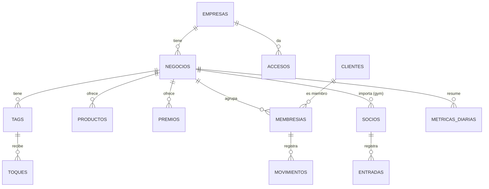

# Arquitectura de Nef

> Cómo está armado todo para que funcione con 1 o con 1.000 negocios. Complementa `PRODUCTO.md`
> (qué) y `PLAN.md` (orden). Si algo aquí choca con el código actual, se migra el código.

## 1. Piezas y quién las usa
```
                         ┌──────────── Cloudflare Pages (borde, cerca del usuario) ────────────┐
Cliente final ── toca ──►│ /t/<codigo>  → valida tag → registra toque → redirige              │
                         │ /n/<slug>/…  → portal, catálogo, club (SSR, liviano)               │
Cajero / recepción ─────►│ /caja/<slug> → sesión con PIN → sumar / canjear (funciona sin red) │
Dueño ──────────────────►│ /panel       → login → solo SU empresa                            │──► Supabase
Jacobo ─────────────────►│ /admin       → login admin → todo                                  │    (Postgres +
Público ────────────────►│ /            → landing de Nef (demos /n/demo-cafe, /n/demo-gym)    │     Auth + Storage
                         └─────────────────────────────────────────────────────────────────────┘     + cron)
```
Una sola base de datos para todos los negocios (**multi-cliente**). Cada fila pertenece a una empresa y
la separación la garantiza la base (RLS), no el código de las páginas.

## 2. Modelo de cuentas
```
empresa (quien paga; ej. "Forja Gym SAS")
 └── negocio / sede (ej. "Forja Gym Chapinero")   ← tiene slug, sector, servicios, tema, tags
      ├── tags (chips/QR)                           ← cada uno con código aleatorio y destino
      ├── catálogo (categorías, productos: plato | clase | máquina | servicio)
      ├── club (premios, reglas, horas doradas)
      ├── membresías (clientes de esa sede o de la empresa si el club es por empresa)
      └── socios + entradas (gimnasio, importadas)
usuarios con acceso
 ├── admin (Jacobo)         → todo
 ├── dueño / gerente        → su(s) empresa(s)            (tabla `accesos`: user_id, empresa_id, rol)
 └── caja (sin usuario)     → una sede, por PIN + sesión corta
cliente final (global)      → identificado por celular; NO ve ni puede ver nada de otros negocios
```
Tablas nuevas respecto a hoy: `empresas(id, nombre, nit, plan, estado_pago, creado)`,
`negocios.empresa_id`, `accesos(user_id, empresa_id, rol: dueno|gerente)`,
`sesiones_caja(token, negocio_id, expira)`. El club puede ser **por sede** (default) o **por empresa**
(`empresas.club_compartido`): así un gimnasio con 3 sedes tiene un solo saldo por socio.

## 3. La base de datos por capas
| Capa | Tablas | Regla |
|---|---|---|
| Configuración | empresas, negocios, tags, categorias, productos, premios, horas_doradas, accesos | Pocas filas, cambian poco. Editadas por admin/dueño. |
| Personas | clientes (global por celular), membresias (cliente × negocio/empresa), socios (gimnasio, por `codigo_externo`) | Datos personales: RLS estricta, nunca en exportaciones. |
| **Hechos (solo se agregan, nunca se editan)** | toques, clicks, eventos_catalogo, movimientos (monedas), entradas, operaciones_caja | Fuente de verdad de todo lo que pasó. Corregir = otro hecho (ej. movimiento `ajuste`). |
| Resúmenes | metricas_diarias(negocio_id, fecha, metrica, valor), saldo y total en membresias | Se recalculan desde los hechos. Los paneles leen de aquí. |

Por qué así: los **hechos** permiten rehacer cualquier número si cambia una definición, y el estudio
estadístico trabaja sobre datos crudos confiables; los **resúmenes** hacen que los paneles carguen
rápido aunque haya millones de filas.

Reglas para todas las tablas:
- Toda fila de negocio lleva `negocio_id` (y por él, la empresa). Índice `(negocio_id, creado)` en hechos.
- Fechas en `timestamptz`; los días y horas "de negocio" se calculan en `America/Bogota`.
- Dinero en **pesos enteros** (`int`/`bigint`), nunca decimales.
- Ids `uuid`; códigos de tag aleatorios de 7+ caracteres (no adivinables); slugs legibles (son públicos).

## 4. Rutas y qué protege cada una
| Ruta | Quién | Protección |
|---|---|---|
| `/` | Cualquiera | Pública (landing) |
| `/t/<codigo>` | Quien toca o escanea | Código aleatorio; si el tag está apagado o el negocio no paga → `/inactivo` |
| `/n/<slug>` y subpáginas | Cualquiera | **Público a propósito**, como una carta en la vitrina: solo información que el negocio quiere mostrar |
| `/n/<slug>/club` | Cliente | Su tarjeta se abre con un **token propio** guardado en su celular, no con el slug |
| `/caja/<slug>` | Personal | PIN → sesión de 12 h (`sesiones_caja`); bloqueo tras 10 intentos/hora |
| `/panel` | Dueño/gerente | Supabase Auth + RLS por `accesos` |
| `/admin` | Jacobo | Supabase Auth + tabla `admins` |
| `/stats?k=` | Dueño (temporal) | Token largo aleatorio; se reemplaza por `/panel` en la Fase 8 |

## 5. ¿Y si alguien escribe la dirección de otro negocio?
Puede **ver** su portal (igual que puede ver la carta en la vitrina), pero **no puede obtener nada de valor**.
Principio: **nada que dé valor se gana visitando un link.**

| Lo que alguien intentaría | Por qué no funciona |
|---|---|
| Ganar monedas desde la casa | Las monedas solo las suma el cajero (sesión con PIN) o el registro de entradas importado del gimnasio |
| Registrarse muchas veces para cobrar la bienvenida | Una por celular, y **la bienvenida se activa con la primera visita en caja** (queda "pendiente" hasta entonces) |
| Canjear premios de otro | El canje lo hace el cajero en persona, viendo al cliente; los premios exigen saldo real |
| Abrir la tarjeta de otra persona | La tarjeta se abre con un token propio; con el celular de otro solo se puede *buscar* en caja (personal) |
| Inflar estadísticas tocando 100 veces | Un mismo dispositivo cuenta una visita por tag cada 30 min (cookie anónima `nef_d`, sin datos personales) |
| Adivinar el código de un chip | 7 caracteres de 31 posibles = más de 27.000 millones de combinaciones; y aun así solo lleva al portal público |
| Entrar a la caja | PIN + bloqueo + sesión corta; el PIN se cambia desde el panel |

**Prueba de presencia (para el futuro):** si algún día algo de valor depende de estar físicamente ahí
(auto-registro de entrada en gimnasios sin torniquete, pedir desde la mesa), se usan chips
**NTAG 424 DNA con SUN**: cada toque genera en el link un código firmado y un contador que el servidor
verifica, así que copiar el link no sirve. Son más costosos que los NTAG213; se usan solo donde haga falta.
Mientras tanto, la entrada por NFC (sin torniquete) solo suma **asistencia**, nunca monedas, y máximo una por día.

## 6. Estadísticas: de los hechos a los paneles
```
hechos (toques, movimientos, entradas…)
   │  cada noche 2:00 a. m. Bogotá (pg_cron) + "hoy" calculado en vivo
   ▼
metricas_diarias (negocio, fecha, métrica, valor)  ──►  panel del dueño / admin (rápido)
   │
   └─ exportación anónima (CSV + diccionario) ──► estudio en R (Jacobo) ──► informe PDF ──► panel
```
- Las definiciones exactas de cada métrica están en `PRODUCTO.md` §8 y se implementan **una sola vez**
  en SQL (funciones `metrica_*`), usadas por el cálculo nocturno y por las pruebas.
- Si una definición cambia: se recalcula `metricas_diarias` desde los hechos (función `recalcular_metricas(negocio, desde)`).
- Los paneles nunca hacen cálculos pesados sobre los hechos crudos de meses atrás.

## 7. Paneles
| Panel | Para quién | Qué tiene |
|---|---|---|
| `/admin` | Jacobo | Empresas y sedes, tags (lotes, asignar, imprimir), servicios por sede, importar entradas, mensualidades, exportar para estudio, subir informes, ver todo como el dueño |
| `/panel` | Dueño/gerente | Resumen (3 números grandes + "en riesgo"), clientes, catálogo (agotados a un toque), premios y reglas del club, informes, PIN de la caja. Si tiene varias sedes: selector arriba |
| `/caja/<slug>` | Personal | Número o escanear → Sumar / Canjear. Nada más |

Diseño: los tres con la marca Nef (`docs/marca/`), simples, una tarea por pantalla.

## 8. Escalabilidad (cuántos negocios aguanta)
- **Borde (Cloudflare):** las páginas se sirven cerca del usuario y escalan solas; el portal pesa < 60 KB.
- **Base (Supabase/Postgres):** con índices `(negocio_id, creado)` y resúmenes diarios, cientos de negocios
  y millones de hechos al mes caben en una sola base. Cuando una tabla de hechos pase ~10 millones de filas,
  se **particiona por mes**.
- **Retención:** hechos crudos 24 meses; resúmenes para siempre; exportaciones del estudio se guardan aparte.
- **Plan:** el plan gratis de Supabase tiene límites de tamaño y no trae copias de seguridad diarias.
  Con el primer cliente que pague, pasar al plan pago (copias diarias) y separar **dos proyectos**:
  `nef-dev` (desarrollo y pruebas) y `nef-prod` (clientes). Nunca desarrollar contra producción.
- **Dominios:** `nef.<dominio>` para la landing y los portales; más adelante, dominio propio por negocio
  (ej. `carta.cafeluna.co`) apuntando al mismo sistema.

## 9. Entornos y despliegue
```
rama desarrollo ──push──► Cloudflare vista previa (+ Supabase nef-dev) ──Jacobo revisa──► merge a main
main ──────────────────► Cloudflare producción (+ Supabase nef-prod)
```
- Variables por entorno en Cloudflare (Production / Preview).
- Cambios de esquema: el SQL es idempotente; se corre primero en `nef-dev`, luego en `nef-prod`.

## 10. Diagrama de datos (resumen)

